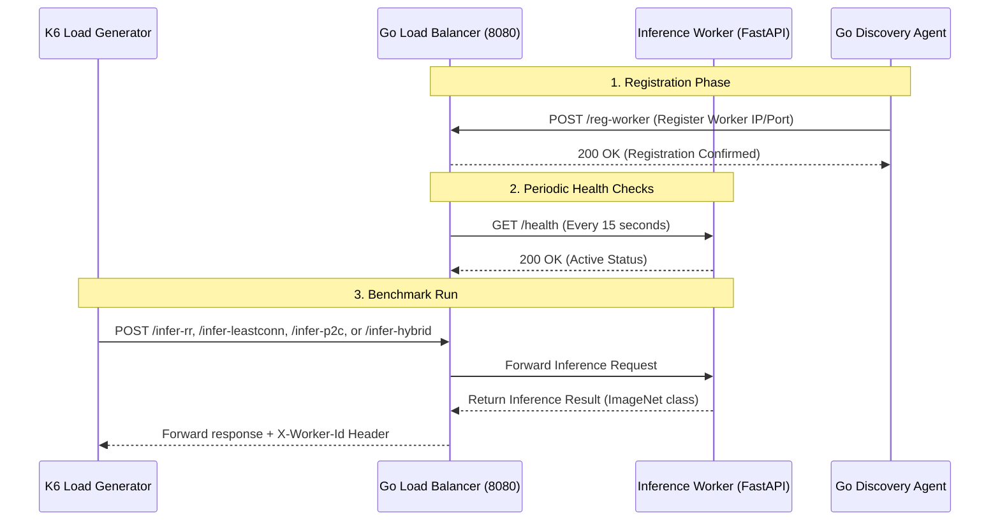

# Neural Network Inference Load Balancer & Scheduler

This repository contains a dynamic, discovery-based load-balancing and scheduling system designed for hosting and evaluating machine learning inference workloads. The architecture routes requests across multiple worker nodes (e.g., Vision Transformers) and evaluates system performance.

---

## 🏗️ System Architecture



### Core Components

1. **Go Load Balancer (`/server`)**: A lightweight reverse proxy serving as the entrypoint (port `8080`). It routes inference traffic across four scheduling endpoints:
   - `POST /infer-rr`: **Round Robin (RR)**
   - `POST /infer-leastconn`: **Least Connections (LC)**
   - `POST /infer-p2c`: **Power of Two Choices (P2C)**
   - `POST /infer-hybrid`: **Hybrid Payload-Aware** (dynamically estimates worker queue load $W_i$ and updates each worker's CPU processing coefficient $\alpha$ via an Exponential Moving Average)
   *(Also exposes `POST /infer-single` for single-worker baseline testing).* It dynamically evicts workers that fail during execution or regular health checks.
2. **Go Discovery Agent (`/img-classifier/discovery`)**: Runs alongside each model container. It registers the worker with the Go proxy and keeps it in the active pool.
3. **FastAPI ViT Worker (`/img-classifier`)**: Python worker exposing a Vision Transformer (`vit-base-patch16-224`) model for ImageNet classification.
4. **K6 Load Tester (`/load-tester`)**: A script simulating concurrent virtual users generating image classification load. It records Time-to-First-Byte (`http_req_waiting`), request duration (`http_req_duration`), request success rates, and individual worker load metrics (`worker_1`, `worker_2`, `worker_3`).

---

## 🛠️ Prerequisites

Ensure you have the following installed on your machine:
* **Go** (v1.23+)
* **Python 3.13+** (preferably with [uv](https://github.com/astral-sh/uv) installed)
* **Docker**
* **k6**

---

## 🚀 Running the Project

### Step 1: Set Up the Environment
At the root of the project, edit the `.env` file to customize settings:
```ini
WORKER_URL=http://localhost
NUM_WORKERS=3
WORKERS_PORT=8000
REGISTRATION_SECRET=change-me-before-deploying
```

### Step 2: Start the Go Load Balancer
You can compile and start the central proxy locally or run it inside a Docker container:

#### Option A: Local Go Binary
```bash
cd server
go run .
```
The server will start listening on port `8080` and wait for workers to register. Make sure a `.env` file exists in the directory or set the environment variables manually.

#### Option B: Containerized Go Server (Docker)
Build and run the load balancer inside a Docker container. In this setup, configuration is done via environment variables:
```bash
# Build the image using the server folder as context
docker build -t nn-schd-server:latest -f server/Dockerfile server

# Start the container with configuration environment variables
docker run -d \
  -p 8080:8080 \
  -e WORKERS_PORT=8000 \
  -e REGISTRATION_SECRET=change-me-before-deploying \
  --name nn-server \
  nn-schd-server:latest
```

### Step 3: Start the Inference Workers
You can run the workers locally on your machine or inside containerized environments:

#### Option A: Local Python Workers (Simulating Multi-Instance)
Start multiple instances of the image classifier on sequential ports (starting at `8000`) using the startup helper:
```bash
cd img-classifier
uv run run_script.sh
```
*Note: In another terminal, run `go run ./discovery/main.go` to register local workers with the scheduler.*

#### Option B: Containerized Docker Workers (Self-Registering)
Build the image classifier client container (which bundles both the FastAPI server and the background discovery agent):
```bash
# Build from repository root
docker build -t img-classifier-client -f img-classifier/Dockerfile .

# Start the container (Requires NVIDIA Container Toolkit on the host)
docker run -d --gpus all \
  -p 8000:8000 \
  -e SCHEDULER_URL=http://<scheduler-ip>:8080 \
  -e REGISTRATION_SECRET=change-me-before-deploying \
  img-classifier-client
```

*Note: The `--gpus all` flag is required for PyTorch to detect and use the host's GPU. Without it, or without the NVIDIA Container Toolkit installed on the host, inference will automatically fall back to the CPU.*

---

## 📊 Performance Benchmarking

### Step 1: Run the Benchmarks
Start the automated load test suite. The script runs benchmarks across the configured load-balancing algorithms (`infer-rr`, `infer-leastconn`, `infer-p2c`, `infer-hybrid`):
```bash
cd load-tester
chmod +x test-all.sh
./test-all.sh
```
As it runs, k6 will export results to a local CSV file inside `load-tester/k6_csv/`.

### Step 2: Analyze and Visualize Performance

Use the analysis and visualizer scripts to parse the k6 output CSVs and generate summary tables and graphs comparing **Round Robin (`/infer-rr`)**, **Least Connections (`/infer-leastconn`)**, **Power of Two Choices (`/infer-p2c`)**, and **Hybrid Payload-Aware (`/infer-hybrid`)**:
```bash
# Install visualization dependencies
uv pip install matplotlib pandas numpy

# Run comparative thesis analysis across all 4 algorithms
python analyze_results.py /path/to/k6_csv/your_test_run_dir

# Or run single-CSV visualizer
python csv-visualizer.py /path/to/k6_csv/your_test_run.csv
```
This produces three critical plots:
1. **QoS / Throughput & Latency Comparison** across the load stages.
2. **Tail Latency** (`http_req_duration` / `http_req_waiting` average, p50, p95, p99, and max) and failed requests.
3. **Traffic Distribution** showing how requests were routed across the 3 worker nodes (`worker_1`, `worker_2`, `worker_3`).
